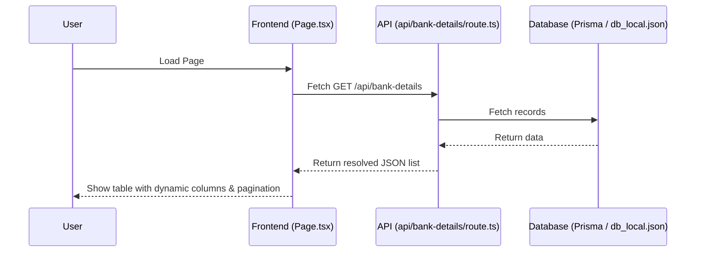

# Global HRMS - Project Structure & Code Explanation

This document outlines the architecture, directory structure, and key files of the **Global HRMS** project. It is structured to help you present the codebase clearly and confidently to your project coordinator/examiner ("Ma'am").

---

## 🚀 1. Overview of the Project
This is a modern **Next.js (App Router)** web application designed for a Human Resource Management System (HRMS). It includes:
* **Dynamic Table Column Settings**: Allowing users to toggle which columns are visible in tables and forms.
* **Database Pooling & Local Emulation**: A robust data layer that connects to PostgreSQL via Prisma but can seamlessly fall back to local JSON file storage (`db_local.json`) if the database is offline.
* **Modular Reusable Form Blocks**: Unified form components (inputs, selects, textareas, etc.) driven by React Hook Form.

---

## 📁 2. Directory Structure (Folder Directory Tree)

Below is the structure of the project:

```yaml
globalhrms/
├── app/                      # Main Next.js App Router directory
│   ├── (auth)/               # Authentication pages (login, registration)
│   ├── (dashboard)/          # Main dashboard views
│   │   ├── bank-details/     # Bank Account Details feature module
│   │   ├── common/           # Common data sync & master data configuration
│   │   ├── dashboard/        # Dashboard modules (attendance, leave, employee)
│   │   └── layout.tsx        # Dashboard layout (Sidebar & Header wrapper)
│   ├── api/                  # Backend REST API Route handlers
│   │   ├── bank-details/     # CRUD operations for Bank Accounts
│   │   ├── common/           # API routes for master/type syncing
│   │   └── employees/        # Employee management API endpoints
│   ├── components/           # Reusable UI & Logic components
│   │   ├── DynamicForm/      # Render forms dynamically from JSON config
│   │   ├── FormBlocks/       # Modular input field components (e.g. Input, Checkbox)
│   │   ├── layout/           # Global layout (Header, Sidebar, Tabs)
│   │   └── ui/               # Base Tailwind CSS components (shadcn buttons, table, etc.)
│   ├── lib/                  # Shared utility code (Prisma client config)
│   └── globals.css           # Global stylesheet containing core styling variables
├── prisma/                   # Prisma ORM setup
│   └── schema.prisma         # Database schema containing all tables (employees, banks, etc.)
├── db.ts                     # Database connection pool manager with JSON emulation fallback
└── db_local.json             # Local database file used when PostgreSQL is offline
```

---

## 🛠️ 3. Key Components & File Breakdown

### 🔹 Database & Backend
1. **`prisma/schema.prisma`**
   * **Role**: Defines the schema and relationships of all database tables (e.g., `bankdetails`, `employees`, `attendance`, `independent_mst`).
   * **Why it matters**: Prisma uses this schema to generate types and perform operations.

2. **[db.ts](file:///c:/Users/ashis/OneDrive/Desktop/NextJs/globalhrms/db.ts)**
   * **Role**: Connects to the database using `pg.Pool`.
   * **Emulation Fallback**: If PostgreSQL isn't configured, it emulates database operations locally by reading/writing to `db_local.json`. This keeps the app running offline.

### 🔹 Bank Details Module (`app/(dashboard)/bank-details/`)
This is the core module managing bank accounts:
1. **[page.tsx](file:///c:/Users/ashis/OneDrive/Desktop/NextJs/globalhrms/app/(dashboard)/bank-details/page.tsx)**
   * **Role**: The main list page. It fetches bank accounts from `/api/bank-details`, defines table columns dynamically based on user settings, and renders the `<DataTable>` component.
2. **[bank-detailsTable.tsx](file:///c:/Users/ashis/OneDrive/Desktop/NextJs/globalhrms/app/(dashboard)/bank-details/components/bank-detailsTable.tsx)**
   * **Role**: A premium TanStack Table component. It handles page numbers, sorting, row counts (e.g., showing 5, 10, or 25 entries), and pagination.
3. **[bank-detailsColumns.tsx](file:///c:/Users/ashis/OneDrive/Desktop/NextJs/globalhrms/app/(dashboard)/bank-details/components/bank-detailsColumns.tsx)**
   * **Role**: Defines table column properties (select rows, actions for editing/deleting, labels, and sort controls).
4. **[FormSettingsModal.tsx](file:///c:/Users/ashis/OneDrive/Desktop/NextJs/globalhrms/app/(dashboard)/bank-details/components/FormSettingsModal.tsx)**
   * **Role**: Settings popup where users can check/uncheck columns to toggle visibility dynamically in lists or forms.

### 🔹 Forms & Custom Controls (`app/components/FormBlocks/`)
Instead of duplicating input codes, we use atomic, modular blocks:
* **`InputBlock.tsx`**: Renders text/number input boxes with floating borders.
* **`CheckboxBlock.tsx`**: Renders custom checkboxes.
* **`TextAreaBlock.tsx`**: Text field wrapper for long notes/descriptions.
* **`SelectBlock.tsx`**: Standard dropdown selectors.
* **`DatePickerBlock.tsx`**: Calendar picker inputs.

---

## 🔄 4. How the Data Flows (Data Lifecycle Example)

When a user opens the **Bank Details** page:

